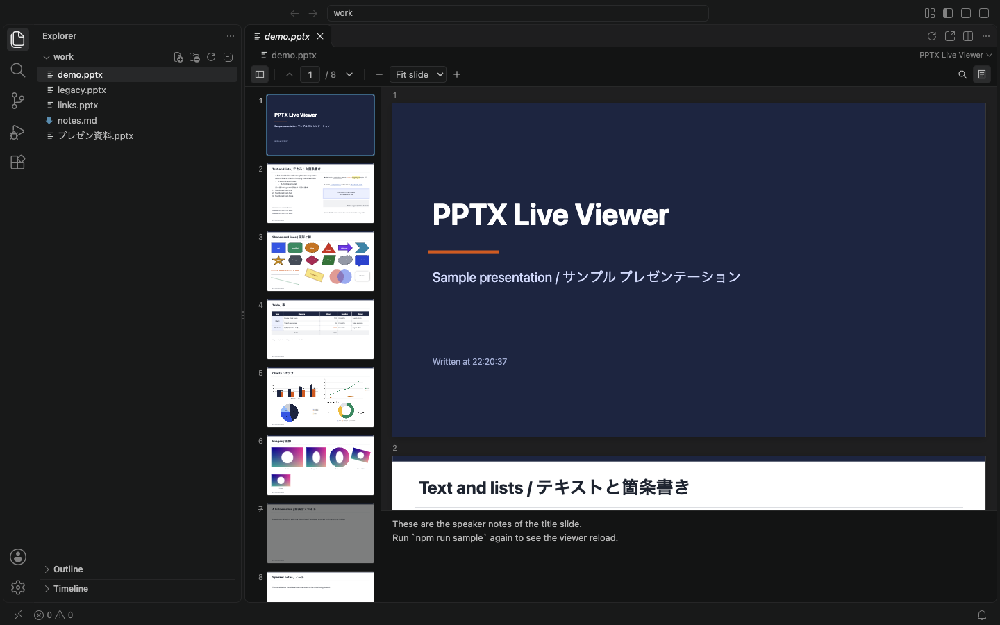

# PPTX Live Viewer

PowerPoint のプレゼンテーションを VS Code のエディター タブで開く拡張機能です。スライドは VS Code の中だけで描画します。PowerPoint も LibreOffice もオンライン サービスも使いません。タブはファイルの変更に追従するので、スクリプトや AI エージェントがプレゼンテーションを書き直すと、見ていた場所のまま新しい内容に切り替わります。



## 機能

- **`.pptx` をほかのファイルと同じように開けます。** エクスプローラーでクリックするだけです。`.pptm`、`.ppsx`、`.ppsm`、`.potx`、`.potm` も同じように開けます。
- **自動で再読み込みします。** ディスク上のファイルが変わると読み直し、表示中のスライド、倍率、スクロール位置、検索をそのまま保ちます。書き込みの途中で読んでしまった場合は少し待って読み直します。読めない状態が続くときは、最後に読めた内容を表示したままお知らせを出します。
- **サムネイルとノート**をそれぞれのパネルに表示します。どちらも閉じられます。非表示スライドには印が付きます。
- **全スライドを検索**できます。大文字と小文字の区別、単語単位、正規表現に対応し、一致した箇所をスライド上で強調します。
- **10%〜400% の拡大・縮小**と、スライド全体・エディターの幅に合わせる表示ができます。ツール バー、キーボード、Ctrl/Cmd + ホイール、トラックパッドのピンチで操作できます。
- **大きなプレゼンテーション**でも、表示位置の近くのスライドだけを描画するので、数百枚あってもすぐに開きます。
- **リンク**に対応しています。Web とメールのリンクはリンク先を確認したうえでブラウザーで開き、ほかのスライドへのリンクはそのスライドへ移動します。
- **データを外部に送りません。**[プライバシーとセキュリティ](#プライバシーとセキュリティ)をご覧ください。
- 表示言語は**日本語と英語**で、VS Code の表示言語に従います。

## 使い方

エクスプローラーからプレゼンテーションを開きます。同じファイルを別のエディターで開きたいときは、**表示: エディターを再度開くアプリケーションの選択...** (View: Reopen Editor With...) を実行します。

スライドの上のツール バーには、スライド番号(番号を入力して Enter で移動)、倍率の操作、検索、サムネイルとノートの切り替えがあります。**再読み込み**と**既定のアプリで開く**はエディターのタイトル バーにあります。

### キーボードとマウス

| 操作 | キー |
| --- | --- |
| 次 / 前のスライド | `→` `←`、`Page Down` / `Page Up`、`Space` / `Shift+Space` |
| 最初 / 最後のスライド | `Home` / `End` |
| 拡大 / 縮小 | `+` / `-`、`Ctrl`/`Cmd` + ホイール、ピンチ |
| スライド全体を表示 | `0` |
| 検索 | `Ctrl`/`Cmd+F` |
| 次 / 前の一致 | `Enter` / `Shift+Enter`、`F3` / `Shift+F3`、`Ctrl`/`Cmd+G` / `Shift+Ctrl`/`Cmd+G` |
| 検索を閉じる | `Esc` |

スライド全体が表示に収まっている間は、方向キー、`Page Down` / `Page Up`、`Space` でスライドを 1 枚ずつ移動します。それより拡大すると、PDF ビューアーと同じようにスクロールします。

### コマンド

プレゼンテーションを開いているとき、コマンド パレットの **PPTX Live Viewer** にすべてのコマンドが表示されます。

| コマンド | ID |
| --- | --- |
| 再読み込み | `pptxLiveViewer.reload` |
| 既定のアプリで開く | `pptxLiveViewer.openInDefaultApp` |
| スライド内を検索 | `pptxLiveViewer.find` |
| スライド番号を指定して移動... | `pptxLiveViewer.goToSlide` |
| 次のスライド / 前のスライド | `pptxLiveViewer.nextSlide` / `pptxLiveViewer.previousSlide` |
| 拡大 / 縮小 | `pptxLiveViewer.zoomIn` / `pptxLiveViewer.zoomOut` |
| スライド全体を表示 | `pptxLiveViewer.zoomToFit` |
| 幅に合わせる | `pptxLiveViewer.zoomToWidth` |
| 実際のサイズ (100%) | `pptxLiveViewer.zoomActualSize` |
| サムネイルの表示/非表示 | `pptxLiveViewer.toggleThumbnails` |
| ノートの表示/非表示 | `pptxLiveViewer.toggleNotes` |

ビューアーの外で効くキーは割り当てていません。コマンドにキーを割り当てるには `keybindings.json` に追加します。

```json
{
  "key": "ctrl+alt+r",
  "command": "pptxLiveViewer.reload",
  "when": "activeCustomEditorId == 'pptxLiveViewer.viewer'"
}
```

### 設定

| 設定 | 既定値 | 説明 |
| --- | --- | --- |
| `pptxLiveViewer.autoReload` | `true` | ディスク上のファイルが変わったときにビューアーを再読み込みします。 |
| `pptxLiveViewer.defaultZoom` | `fit` | 開いたときの倍率。`fit`(スライド全体)、`width`(エディターの幅)、`actual`(100%)。 |
| `pptxLiveViewer.thumbnails` | `true` | 開いたときにサムネイルを表示します。 |
| `pptxLiveViewer.notes` | `auto` | 開いたときにノートのパネルを表示するかどうか。`auto`(ノートがあるときだけ)、`show`、`hide`。 |

開いているタブの倍率、表示中のスライド、パネルの状態は、タブを閉じるまで保たれます。

## 表示について

スライドは [pptx-renderer](https://github.com/aiden0z/pptx-renderer) が HTML と SVG で描画します。文字、図形、画像、表、グラフ、テーマ、レイアウトといった一般的な内容は PowerPoint に近い見た目になりますが、PowerPoint とは別の描画エンジンであり、あくまでビューアーです。

- プレゼンテーションの編集はできません。
- アニメーションと画面切り替えは再生しません。スライド ショーの機能もありません。
- グラフは Canvas に描画します。細部が PowerPoint と異なることがあり、高い倍率では輪郭がぼやけます。
- 文字にはお使いのコンピューターにあるフォントを使います。無いフォントは、PowerPoint と同じく別のフォントに置き換わります。
- 検索の対象はスライド上の文字です。ノートと、番号付きリストやスライド番号のフィールドが作る番号は対象になりません。
- パスワードで保護されたプレゼンテーションと、古い `.ppt` 形式は開けません。

スライドの一部を描画できなかったときは、ツール バーに警告と件数が表示されます。クリックすると、詳細を記録した出力チャネル **PPTX Live Viewer** が開きます。

## プライバシーとセキュリティ

プレゼンテーションは外から来たファイルです。ビューアーはそのつもりで扱います。

- ファイルの読み取りと描画はすべて手元で行います。拡張機能はネットワークに接続せず、利用状況の情報も集めません。
- ビューアーは、厳しいコンテンツ セキュリティ ポリシー (`default-src 'none'`) を設定したサンドボックス内の Webview で動きます。プレゼンテーションが Web 上の画像やメディアを参照していても取得しません。
- リンクを開くのは、利用者がクリックしたときだけです。`http`、`https`、`mailto` のリンクに限り、実際のリンク先を表示して確認したうえで開きます。
- 制限モードでも動きます。ワークスペース内のコードは実行しません。

## 開発

```bash
npm install --ignore-scripts
npm run build      # 拡張機能とビューアーを dist/ にまとめる
npm run check      # 型チェックと単体テスト
npm run sample     # dev/samples/sample.pptx を作る
npm run dev        # ブラウザーのタブでビューアーを開く: http://127.0.0.1:5177/dev/
npm run package    # .vsix を作る
```

VS Code で `F5` を押すと、拡張機能開発ホストで試せます。開発用のページは、同じビューアーを普通のブラウザーのタブで動かすもので、開発者ツールが使えます。ページを開いたまま `npm run sample` をもう一度実行すると、再読み込みの様子を確認できます。

## ライセンス

[MIT](https://opensource.org/license/mit)。配布するパッケージには pptx-renderer (Apache-2.0)、Apache ECharts (Apache-2.0)、JSZip (MIT) と、それらが依存するパッケージが含まれます。それぞれの表示はパッケージ内の `dist/ThirdPartyNotices.txt` にあります。

PowerPoint は Microsoft グループの商標です。この拡張機能は Microsoft と提携しておらず、Microsoft の承認を受けたものでもありません。
