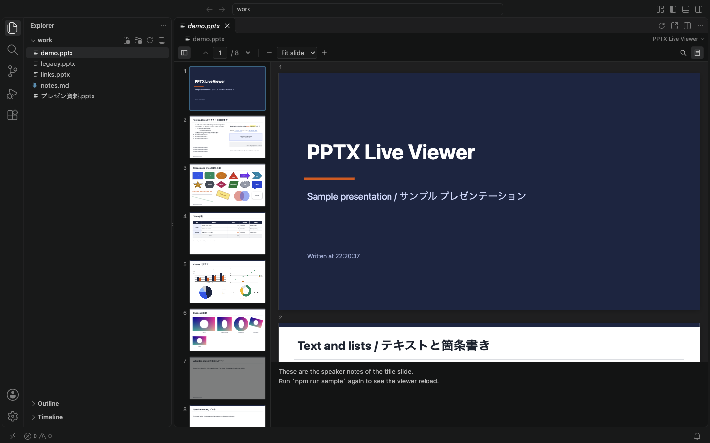

# PPTX Live Viewer

Open PowerPoint presentations in a VS Code editor tab. The slides are drawn inside VS Code itself — no PowerPoint, no LibreOffice, no online service — and the tab follows the file: when a script or an AI agent writes the presentation again, the new version appears where you were looking.



## Features

- **Opens a `.pptx` like any other file.** Click it in the Explorer. `.pptm`, `.ppsx`, `.ppsm`, `.potx` and `.potm` work the same way.
- **Live reload.** When the file changes on disk the viewer reads it again and keeps the slide, the zoom, the scroll position and the search. A file caught half-written is tried again; if it stays unreadable, the last good version stays on screen with a notice.
- **Thumbnails and speaker notes**, each in a panel that can be turned off. Hidden slides are marked.
- **Find** in all slides, with match case, whole word and regular expressions. Matches are highlighted on the slides.
- **Zoom** from 10% to 400%, to the whole slide or to the editor width, with the toolbar, the keyboard, or Ctrl/Cmd + wheel and trackpad pinch.
- **Large presentations.** Only the slides near the view are drawn, so a deck with hundreds of slides opens quickly.
- **Links.** Web and mail links open in the browser after you confirm the address; links to other slides jump there.
- **Nothing leaves your machine.** See [Privacy and security](#privacy-and-security).
- **English and Japanese** interface, following the display language of VS Code.

## Usage

Open a presentation from the Explorer, or with **File: Open File...**. To use another editor for the same file, run **View: Reopen Editor With...**.

The toolbar above the slides has the slide number (type a number and press Enter to go there), the zoom controls, the search, and the switches for the thumbnails and the notes. **Reload** and **Open in Default App** are in the title bar of the editor.

### Keyboard and mouse

| Action | Keys |
| --- | --- |
| Next / previous slide | `→` `←`, `Page Down` / `Page Up`, `Space` / `Shift+Space` |
| First / last slide | `Home` / `End` |
| Zoom in / out | `+` / `-`, or `Ctrl`/`Cmd` + wheel, or pinch |
| Fit the slide | `0` |
| Find | `Ctrl`/`Cmd+F` |
| Next / previous match | `Enter` / `Shift+Enter`, `F3` / `Shift+F3`, `Ctrl`/`Cmd+G` / `Shift+Ctrl`/`Cmd+G` |
| Close the search | `Esc` |

While a whole slide fits in the view, the arrow keys, `Page Down` / `Page Up` and `Space` move from slide to slide. Once you zoom in further they scroll instead, like in a PDF viewer.

### Commands

All commands are in the Command Palette under **PPTX Live Viewer** while a presentation is the active editor.

| Command | ID |
| --- | --- |
| Reload | `pptxLiveViewer.reload` |
| Open in Default App | `pptxLiveViewer.openInDefaultApp` |
| Find in Slides | `pptxLiveViewer.find` |
| Go to Slide... | `pptxLiveViewer.goToSlide` |
| Next Slide / Previous Slide | `pptxLiveViewer.nextSlide` / `pptxLiveViewer.previousSlide` |
| Zoom In / Zoom Out | `pptxLiveViewer.zoomIn` / `pptxLiveViewer.zoomOut` |
| Zoom to Fit Slide | `pptxLiveViewer.zoomToFit` |
| Zoom to Fit Width | `pptxLiveViewer.zoomToWidth` |
| Zoom to Actual Size (100%) | `pptxLiveViewer.zoomActualSize` |
| Toggle Thumbnails | `pptxLiveViewer.toggleThumbnails` |
| Toggle Speaker Notes | `pptxLiveViewer.toggleNotes` |

The extension binds no keys of its own outside the viewer. To give a command a key, add it to `keybindings.json`:

```json
{
  "key": "ctrl+alt+r",
  "command": "pptxLiveViewer.reload",
  "when": "activeCustomEditorId == 'pptxLiveViewer.viewer'"
}
```

### Settings

| Setting | Default | Description |
| --- | --- | --- |
| `pptxLiveViewer.autoReload` | `true` | Reload the viewer when the file changes on disk. |
| `pptxLiveViewer.defaultZoom` | `fit` | Zoom when a presentation is opened: `fit` (whole slide), `width` (editor width) or `actual` (100%). |
| `pptxLiveViewer.thumbnails` | `true` | Show the thumbnails when a presentation is opened. |
| `pptxLiveViewer.notes` | `auto` | Show the notes panel when a presentation is opened: `auto` (only if the presentation has notes), `show` or `hide`. |

The zoom, the current slide and the panels of an open tab are remembered for as long as the tab stays open.

## What to expect

The slides are drawn as HTML and SVG by [pptx-renderer](https://github.com/aiden0z/pptx-renderer). The result is close to PowerPoint for the usual content — text, shapes, pictures, tables, charts, themes and layouts — but it is a different renderer, and it is a viewer:

- Presentations cannot be edited.
- Animations and transitions are not played, and there is no slide show mode.
- Charts are drawn onto a canvas. Details can differ from PowerPoint, and a chart looks soft at high zoom.
- Text uses the fonts installed on your machine. A font that is missing is replaced by another one, as PowerPoint does.
- The search covers the text on the slides. It does not cover speaker notes, nor the numbers that numbered lists and slide number fields produce.
- Password-protected presentations and the old `.ppt` format cannot be opened.

When part of a slide cannot be drawn, a warning with the number of such parts appears in the toolbar. Click it to open the **PPTX Live Viewer** output channel, where the details are listed.

## Privacy and security

A presentation is a file from somewhere else, and the viewer treats it that way.

- The file is read and drawn locally. The extension makes no network requests and collects no telemetry.
- The viewer runs in a sandboxed webview with a strict Content Security Policy (`default-src 'none'`). Pictures and media that a presentation refers to on the web are not fetched.
- A link is opened only when you click it, only if it is an `http`, `https` or `mailto` link, and only after you confirm the address it really points to.
- The extension works in Restricted Mode: it runs no code from the workspace.

## Development

```bash
npm install --ignore-scripts
npm run build      # bundles the extension and the viewer into dist/
npm run check      # type check and unit tests
npm run sample     # writes dev/samples/sample.pptx
npm run dev        # the viewer in a browser tab: http://127.0.0.1:5177/dev/
npm run package    # builds the .vsix
```

Press `F5` in VS Code to try the extension in an Extension Development Host. The development page runs the same viewer in a plain browser tab with its developer tools; run `npm run sample` again while it is open to see a reload.

## License

[MIT](https://opensource.org/license/mit). The packaged extension includes pptx-renderer (Apache-2.0), Apache ECharts (Apache-2.0), JSZip (MIT) and the packages they depend on; their notices are in `dist/ThirdPartyNotices.txt` inside the package.

PowerPoint is a trademark of the Microsoft group of companies. This extension is not affiliated with or endorsed by Microsoft.
